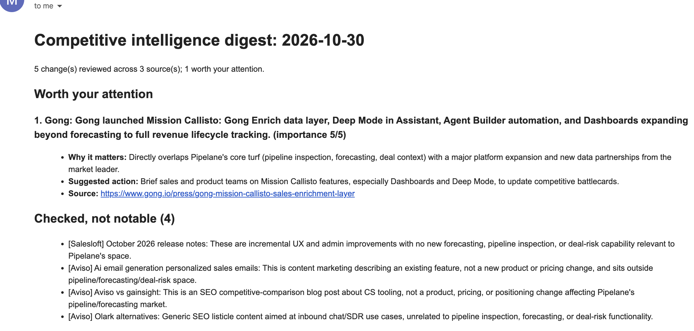

# Competitive Intelligence Agent

A weekly digest of what changed on five competitors' public pages, and whether it matters. It watches release notes, press pages, homepages and sitemaps, detects what is new, asks Claude to judge relevance, and emails a short ranked digest with a source link for every claim. It runs unattended on GitHub Actions.

It is built for **Pipelane**, a fictional company that sells AI pipeline-visibility and deal-risk software to B2B SaaS revenue teams. The competitors are real: Gong, Salesloft (which now includes Clari), Aviso, Terret (formerly BoostUp) and Backstory (formerly People.ai).

I built it to practise running AI unattended: scheduled runs, memory between runs, change detection, relevance judgement, and failures that are reported instead of hidden. The collection and change-detection code involves no AI, so it can be tested. Claude is used for one thing: deciding which changes matter to a revenue team.

**Stack:** Python, requests, BeautifulSoup, Claude (Anthropic API), Gmail SMTP, pytest, GitHub Actions

## Example

This is a simulated week. I removed a few items from last week's snapshot so the pipeline had something to report. The real runs so far have been quiet.



The full text is in [`examples/example-digest-simulated.md`](examples/example-digest-simulated.md).

## How it works

```
GitHub Actions (Mondays, 06:23 UTC) or manual trigger
  -> run the tests
  -> fetch 11 sources, save a snapshot of each
  -> compare with last run's snapshot (no AI)
  -> Claude judges each change: notable or not, importance 1 to 5,
     why it matters to Pipelane, suggested action
  -> write the digest, email it
  -> commit the new snapshots and run log back to the repo
```

## What it watches

I tested each source with a plain HTTP request before choosing it. The full reasoning is in [`SCOPE.md`](SCOPE.md).

| Company | Source | How change is detected |
|---|---|---|
| Gong | Release notes and monthly updates | New or changed lines of text |
| Gong | Press page and sitemap | New links |
| Salesloft | Release notes | New links |
| Aviso | Press page and blog | New links |
| Terret | Homepage and sitemap | Text changes, new URLs |
| Backstory | Homepage and sitemap | Text changes, new URLs |

What the source check found:

- **No competitor publishes list pricing.** Pricing pages are demo forms or redirects, so pricing is not monitored.
- **Mergers break addresses.** Clari's old community and pricing URLs now redirect to Salesloft.
- **Some pages need JavaScript.** Salesloft's newsroom list does not appear in the HTML a plain request receives, so it is out of scope.
- **Volume is not signal.** Aviso's blog publishes several posts a month, mostly SEO content, which makes it a good test of relevance judgement.

## Design decisions

- **Silence is a valid output.** With no changes, the digest says so and no API call is made.
- **Claude never writes links.** The model returns a change number, and the code attaches the URL. Every link in a digest is one the code collected.
- **A failed fetch is reported, never hidden.** A failing source keeps its last good snapshot, appears under "Source problems" in the digest, and turns the workflow run red. Sources that failed are excluded from the comparison, so stale data is not reported as news.
- **Bad model output cannot disappear.** Changes are reviewed in batches of ten. If a batch comes back unreadable, those changes are listed as "Not assessed" instead of being dropped.
- **A stale digest is never sent.** The email step only sends today's digest.
- **The importance threshold is enforced in code**, not left to the prompt, so a low-importance item cannot land in "Worth your attention".
- **Noise is filtered at the source.** Sitemaps ignore taxonomy pages and report only new URLs, and each source's new items are capped.
- **No competitor text is republished.** The repository stores a hash of each page line, not the line. The text itself is kept only for the current run.

## Tests

19 automated tests, run before every scheduled job. They need no network and no API key. They cover change detection (new items, sitemap noise, redesign detection), the failed-source behaviour, the importance threshold, parsing of model replies, and the guards that stop a stale digest being sent or old data being compared.

```
python3 -m pytest -q
```

## What building it taught me

- **A crash led to a stale email.** An end-to-end run crashed in the digest step, and the email step went on to send the previous digest. Nothing in the output looked wrong. The email step now refuses anything that is not today's digest, and a test covers it.
- **Whole-site sitemaps are noisy.** One competitor restructured its site and 37 taxonomy pages disappeared at once. Sitemaps now report only new pages, and a source can list URL patterns to ignore.
- **I almost published other companies' text.** The first snapshot design stored full page text. I caught this in a pre-commit check and changed it to hashes.
- **The model's claims held up under checking.** I compared the digest's statements about one announcement with the page itself, twice, and found no invented details. Reading the page was still necessary, because the model had only seen part of it the first time.
- **The same item scored differently between runs.** One announcement was rated 4 out of 5, then 5 out of 5. The judgement was consistent but the number was not, which is why the threshold sits in code.

## Limitations

- **Relevance has not been measured.** I have not yet labelled a set of past changes to score how often Claude agrees with a human. So far I have judged quality by reading digests.
- **One simulated week, and a quiet real one.** There is not yet a track record of weekly runs.
- **Importance scores are not stable** between runs of the same input.
- **Summaries can repeat a vendor's own claims.** One digest called a company "the market leader", which came from its press release.
- **Plain HTML only.** Pages that need JavaScript are out of scope.
- **Text diffs are line based.** A rotating banner on a homepage could create noise over several weeks.
- **Removed lines are counted, not shown**, because the text is not stored.
- **Scheduled runs are best effort.** GitHub can delay them, and in rare cases drop them. The workflow commits its run log every week, which should stop GitHub pausing the schedule after 60 days of repository inactivity.
- **The repository is public**, so digests and snapshots are too. They contain only links, short titles and summaries of public pages.

## If this were a real deployment

- Label a test set of past changes and track agreement with a human reviewer over time.
- Use a monitoring service for sources that need a browser, and keep a source list per competitor.
- Send alerts to the channel the commercial team already uses, and keep the email as a fallback.
- Review the digest weekly and feed corrections back into the prompt.
- Add retries and a separate alert when a source has been failing for several weeks.

## Run it yourself

```
git clone https://github.com/manospapadog/ai-portfolio.git
cd ai-portfolio/competitive-intel-agent
python3 -m venv venv
source venv/bin/activate
pip install -r requirements.txt
cp .env.example .env    # then fill in your own values
```

Run the steps one at a time:

```
python3 fetch.py        # the first run saves baseline snapshots
python3 fetch.py        # the second run has something to compare against
python3 diff.py
python3 digest.py
python3 send_email.py
```

For the scheduled version, add four repository secrets in GitHub (`ANTHROPIC_API_KEY`, `GMAIL_ADDRESS`, `GMAIL_APP_PASSWORD`, `DIGEST_TO`). The workflow is in `.github/workflows/competitive-intel.yml` at the root of the repository, and can also be started by hand from the Actions tab.

## Files

| File | Purpose |
|---|---|
| `sources.py` | The list of pages being watched |
| `fetch.py` | Fetches each source and saves a snapshot |
| `diff.py` | Compares this run with the last, with no AI |
| `digest.py` | Asks Claude to judge each change and writes the digest |
| `send_email.py` | Emails today's digest |
| `tests/` | Automated tests |
| `scripts/` | The scripts I used to test each source before choosing it |
| `SCOPE.md` | The scope note written before building |
| `snapshots/latest/` | The current snapshot of each source |
| `runs.jsonl` | A log of every run |
| `digests/` | Every digest the scheduled job has produced |
| `examples/` | A digest from a simulated week |