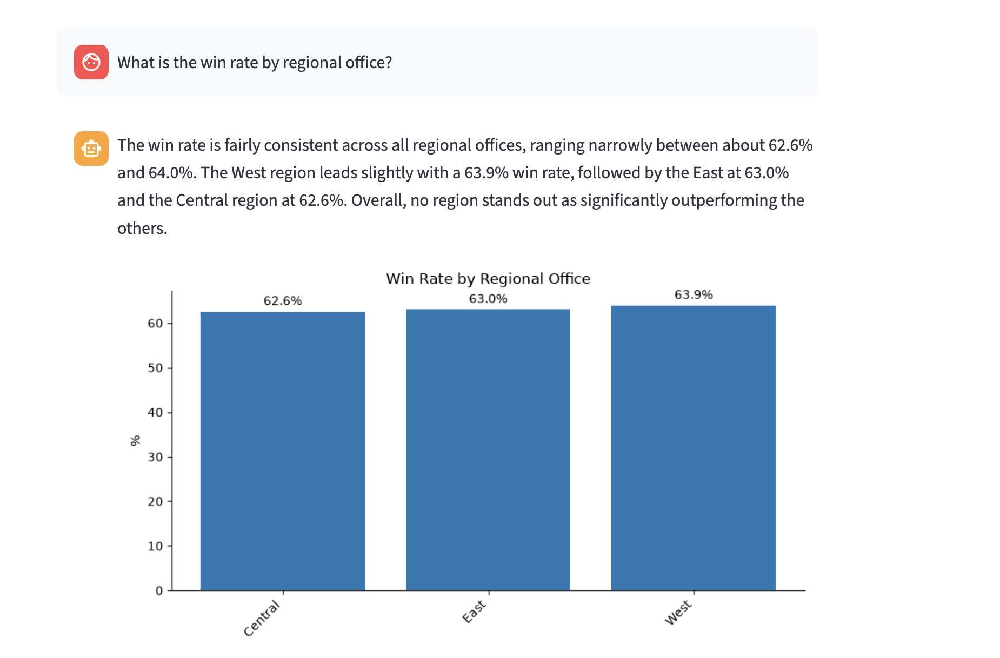
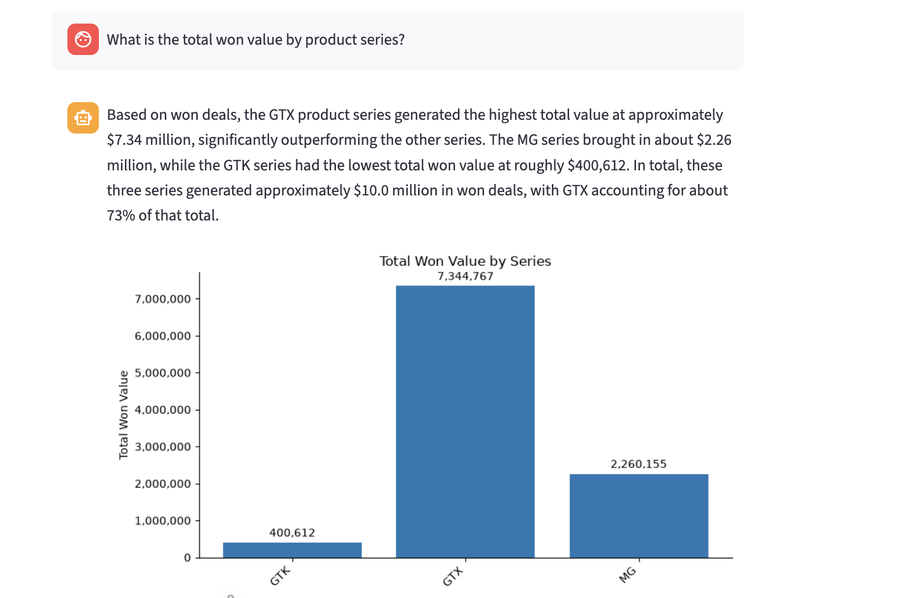

# Commercial Ops Copilot

Ask questions about CRM sales data in plain English. The copilot writes the SQL, runs it against the database, and returns a short summary, a chart when the result suits one, and the exact query it used. It makes exploratory analysis quicker, without writing a stack of SQL queries by hand.

I built it to learn how to build reliable AI systems, not only prompt them. The focus is correctness: every answer comes from a real query, the SQL is always visible, and a test suite checks results against hand-written SQL.

**Stack:** Python, SQLite, pandas, matplotlib, Streamlit, Claude (Anthropic API)

## Demo





Each answer in the app also has two expandable sections: the raw data table and the SQL that produced it.

## How it works

```
Question in plain English
  -> Claude writes a SQLite query
     (given the schema, the real values of category
      columns, and a few business definitions)
  -> Safety check: one read-only SELECT only
  -> Query runs on a read-only database connection
  -> Claude summarises the returned rows
  -> Chart is drawn if the result is a label plus a number
  -> App shows summary, chart, data table and SQL
```

## Example questions

- What is the win rate by regional office?
- Who are the top 5 sales agents by total won value?
- How much revenue did we close per month?
- Which sector has the highest total won value?
- How many days does it take on average to close a won deal?
- What is the total won value by product series?

Questions it should refuse, such as "Delete all lost deals" or "What will our revenue be next quarter?", get a plain "I can't answer that" message.

## Safety

- The model is told to return a single read-only query, or `CANNOT_ANSWER` for anything that modifies data or can't be answered from the schema.
- Independently of the model, generated SQL is rejected unless it is a single SELECT or WITH statement with no write keywords.
- The database is opened in read-only mode, so even a query that slipped through couldn't change data.

## Evaluation

There are 15 test questions: 13 with a correct answer and 2 that should be refused. For each answerable question I wrote the correct SQL by hand, and the test compares the result table from Claude's SQL against mine. Row order, column names and rounding are ignored, and extra columns are allowed, but row count and values must match.

Run it with `python3 eval.py`. The latest results are in `eval_results.md`.

| Step | Score | What happened |
|---|---|---|
| First run, 10 questions | 9/10 | My checker rejected a correct answer because it included extra columns. I fixed the checker. |
| Same 10 questions, 3 runs | 10/10 each | Identical results across runs. |
| Added 4 questions the prompt had not been tuned on | 13/14 | The model filtered on `technology`, but the data spells it `technolgy`, so the query returned nothing. |
| Showed the model the real values of category columns | 13/14 | The model's answer was now correct. My answer key had an arbitrary `LIMIT 5` the question never asked for, so I fixed the key. |
| Added a product-series question | 14/15 | Real failure, described below. |
| Added a prompt note about the quirk | 15/15 | |

**Caveat:** the prompt was tuned using these same questions, so 15/15 is not an unbiased accuracy figure. Of the four questions added after tuning, three passed on the first try. The test suite is small, and its value is in the failures it exposed.

## What the tests caught

**A silent join bug.** Product names are spelled `GTXPro` in the pipeline table and `GTX Pro` in the products table. Claude joined the two tables on product name, which silently dropped every GTXPro deal. The query ran without error and returned plausible numbers, but the GTX series came back as 3,834,189 instead of 7,344,767, about 3.5M too low. Only the hand-written ground truth exposed it. I fixed it with a prompt note about the quirk.

**A typo in the data.** The sector `technolgy` is misspelled in the source data. A question about "technology" returned an empty table, with no error. Giving the model the actual values of low-cardinality columns fixed this in general, not only for this one word.

**Two failures were my tests, not the model.** One checker was too strict about extra columns, and one answer key had a `LIMIT` the question never asked for. Checking each failure before changing anything was part of the point.

## Limitations

- Each question is answered on its own. There are no follow-up questions with memory.
- The product-name fix is a prompt note about one known quirk. Unknown quirks would still slip through, which is what ground-truth tests are for.
- Summaries are written by the model from the returned rows and can round or phrase loosely. The table and SQL are the source of truth.
- Charts are simple bar charts, drawn only for two-column results.
- The test suite is small, and the prompt was tuned against it.
- The source data has typos (`technolgy`, `Philipines`).

## If this were a real deployment

- Clean the data at load time (for example, normalise product names) instead of patching it in the prompt.
- Use a data warehouse and a read-only database user instead of a local SQLite file, with per-user access control.
- Keep metric definitions such as "win rate" in one maintained place, so everyone gets the same number.
- Add query logging, rate limits and a spend cap on API usage.
- Handle data governance. The app sends the question, schema, category values and up to 50 result rows to the Anthropic API, so sensitive data would need an approved provider setup or redaction.
- Compare against buying: many BI tools now have natural-language query layers, which is often the right first step for a real company.

## Run it yourself

```
git clone https://github.com/manospapadog/ai-portfolio.git
cd ai-portfolio/project-1-copilot
python3 -m venv venv
source venv/bin/activate
pip install -r requirements.txt
cp .env.example .env    # then add your Anthropic API key
```

The data files are not included. Download the dataset and put the CSVs in a `data/` folder (see `DATA.md`), then:

```
python3 build_db.py
streamlit run app.py
python3 eval.py
```

## Data

Maven Analytics "CRM Sales Opportunities" sample dataset (a fictitious B2B hardware company): 8,800 opportunities, 85 accounts, 7 products, 35 sales agents. Details and download link in `DATA.md`.

## Files

| File | Purpose |
|---|---|
| `app.py` | Streamlit chat interface |
| `text_to_sql.py` | SQL generation, safety check, query execution, summary and chart |
| `schema_context.py` | Reads the schema and category values for the prompt |
| `build_db.py` | Builds `crm.db` from the CSV files |
| `eval.py`, `eval_results.md` | Test suite and its latest results |
| `ground_truth_queries.sql` | Hand-written queries used while validating |
| `ARCHITECTURE.md` | Original design notes, written before the build |
| `DATA.md` | Where the data comes from and how to rebuild the database |