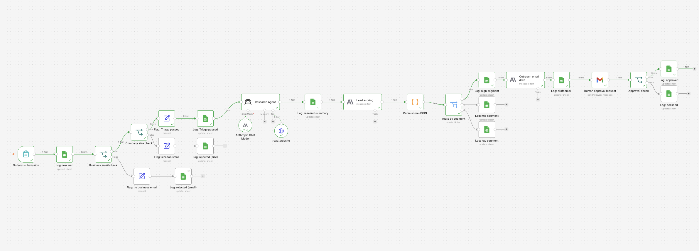
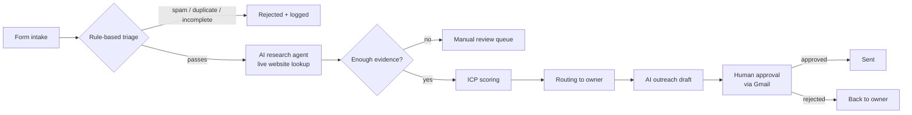

# Lead Desk: Intake → Score → Outreach

**An n8n workflow that takes an inbound lead from form submission to a researched, scored, routed lead with a personalised first email waiting for human approval.**

Sales teams lose good leads in the gap between "someone filled in the form" and "the right person reached out with something relevant to say". Lead Desk closes that gap. It filters out noise with rules, uses AI only where judgement is needed, and keeps a human in charge of anything that leaves the building.

---

## How it works

| Step | What happens | Rules or AI? |
|---|---|---|
| **1. Intake** | A form submission triggers the workflow. | Rules |
| **2. Triage** | Rejects free email domains, missing required fields and duplicates before anything reaches a model. | Rules |
| **3. Research** | An AI agent visits the company's website and returns a structured profile (industry, size, product, likely use case). Every field must cite a source URL or be returned as `unknown`. | AI |
| **4. Evidence check** | Leads with too many unknowns skip scoring and go to manual review. | Rules |
| **5. ICP scoring** | The profile is scored against ideal-customer criteria. | Rules + AI profile |
| **6. Routing** | The lead is assigned to an owner based on score and segment. | Rules |
| **7. Outreach draft** | A second AI step writes a short first email that references what the research found. | AI |
| **8. Approval** | The draft is sent to the owner in Gmail for approval. Nothing goes to the lead automatically. | Human |

---

## Design decisions

- **Rules before AI.** Triage is deterministic: it's cheap, predictable and easy to debug. The model only sees leads worth researching.
- **AI does two jobs, and only two.** Research and writing. Scoring thresholds, routing and approval stay deterministic, so the workflow's behaviour can be explained and audited.
- **"Unknown" beats a confident guess.** The research agent must back every field with a source or say it doesn't know. A thin profile goes to a human instead of quietly distorting the score.
- **A human approves every email.** Speed comes from preparing the work, not from removing judgement.

---

## Testing

I tested the workflow end to end with a set of leads whose correct outcome I already knew. The set covered:

- strong-fit companies with detailed websites
- tiny companies with one-page or near-empty websites
- fake or parked domains
- duplicate submissions and free email addresses
- incomplete form entries

For each lead I compared the triage result, research profile, score, routing and draft against what I would have decided by hand.

## What failed, and what I changed

**Problem:** small companies with thin websites scored too high. When the site had little content, the research agent filled the gaps with plausible guesses about company size and industry. The scoring step then treated those guesses as facts, so weak-evidence leads were ranked as strong fits.

**Fix:**
1. Changed the research agent's output schema: every field needs a source URL or is returned as `unknown`.
2. Added an evidence check before scoring. Leads with more than two `unknown` fields skip automated scoring and go to a manual review queue.
3. Re-ran the full test set to confirm that strong-fit leads still scored correctly and thin-evidence leads were routed to review.

---

## Built with

- **n8n**: orchestration, triage rules, routing
- **[TODO: LLM provider and model]**: research agent and outreach drafting
- **[TODO: form tool]**: lead intake
- **Gmail**: human approval step

## Run it yourself

1. Import `lead-desk-workflow.json` into n8n (**Workflows → Import from file**).
2. Add your own credentials for the LLM provider and Gmail. None are included in this repo.
3. Edit the ICP criteria and routing rules to match your own segments.
4. Submit a test lead through the form and approve the draft in Gmail.

## Files

| File | Contents |
|---|---|
| `README.md` | This document |
| `lead-desk-workflow.png` | Screenshot of the full n8n workflow |
| `lead-desk-workflow.json` | Exported workflow, with credentials removed |

---

*Part of my [AI portfolio](../README.md): tools that automate the commercial operations work I used to do by hand.*
